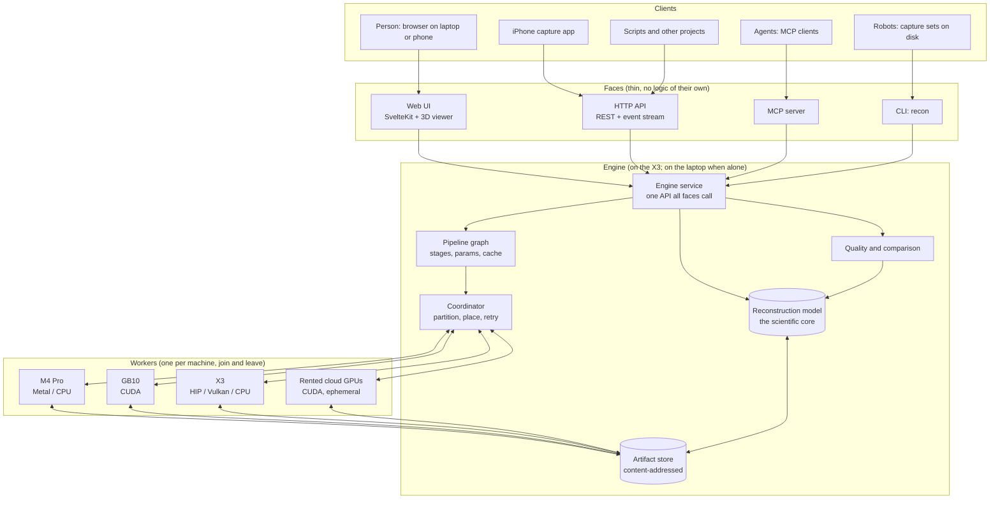
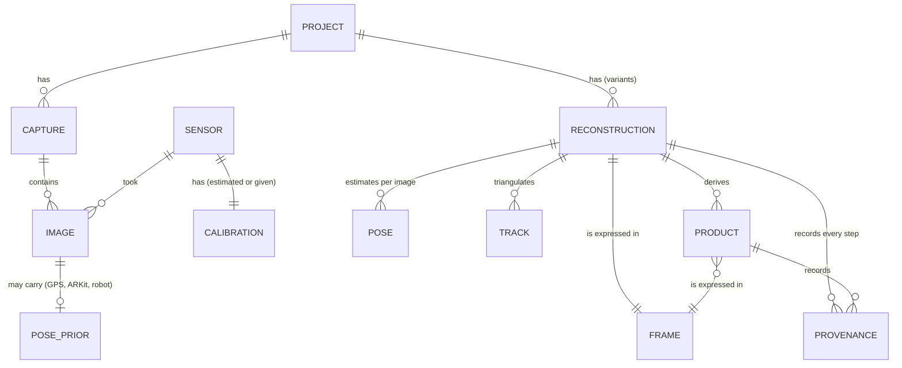
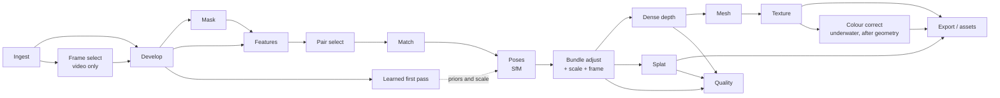
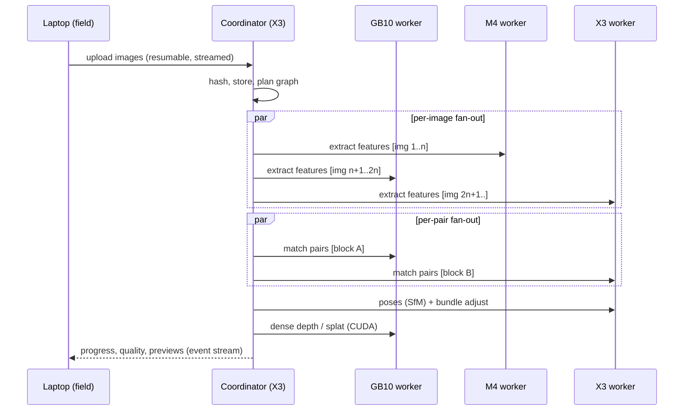

# Architecture sketch — the logical shape

*Working sketch for discussion. Input to the Step 0 prototypes and to PG-04 Technical
Architecture. Written before any prototype exists, so every component here is a hypothesis the
prototypes test, and every library choice is a candidate, not a decision.*

**Version:** 0.1 · Draft · 2026-11-23
**Inputs:** [brief](PG-brief.md) · [tools overview](../reference/tools-overview.md) ·
[primer](../reference/photogrammetry-primer.md) · [hardware](../wip/hardware-and-parallelism.md) ·
[robotics-lab contract](../wip/robotics-lab-contract.md)

---

## 1. The shape in one picture



Three rings. **Faces** translate a request into a call on the engine service and render the answer;
they hold no logic. **The engine** owns the reconstruction model, decides what work to do and where,
and judges the result. **Workers** do the computation and know nothing about projects, people or
agents — they receive a task, fetch its inputs by hash, run one stage, and return outputs by hash.

## 2. The reconstruction model — the core everything is built around

The engine's centre is one structured model of a reconstruction. Every face shows it, every stage
reads and writes it, every comparison is between two of them.



| Entity | What it holds | Why it is first-class |
|---|---|---|
| **Capture** | A set of images from one session and device, with how they were taken | Underwater, drone, turntable and robot captures behave differently; the engine needs to know which it has |
| **Image** | File hash, decoded form, EXIF/XMP, mask, develop settings | Content-addressed so a re-run never re-decodes; develop settings are part of provenance |
| **Sensor + Calibration** | Camera model (pinhole, Brown, fisheye, later refractive), intrinsics, their uncertainty, source (EXIF guess, given, estimated) | One body and lens shared across images; robots and ARKit give calibrations, the engine estimates the rest |
| **Pose prior** | Pose from GPS, ARKit, gimbal or a robot, with frame, source (`truth`/`belief`/`device`) and uncertainty | Priors are inputs the engine uses and reports on, never silently trusted or ignored |
| **Reconstruction** | Estimated poses, tracks, sparse points, the parameters and stage versions that produced them | A project holds several — classical vs learned, with vs without priors — and compares them |
| **Frame** | Named frame, axes, units, and **scale state**: `metric`, `metric-from-priors`, `scaled-by-markers` or `arbitrary` | The "main trap" robotics-lab named: a model never leaves without saying what its scale means |
| **Product** | Dense cloud, mesh, texture, splat, asset export, each with its frame | Products are derived and replaceable; the poses are the asset |
| **Provenance** | Inputs (hashes), stage, implementation, version, parameters, machine, time, licence of the implementation | Same input and parameters give the same output; licence travels with the result |
| **Quality** | Per image, per track, per region: registered or not, reprojection error, track length, coverage, uncertainty | What the UI draws and an agent reads to say "capture more here" |

On disk the model is language-neutral: a documented schema (JSON for structure, Arrow/Parquet for
large tables such as tracks and points), with COLMAP's format as an import/export, never as the
internal truth. This is what keeps a future Rust coordinator or worker possible.

## 3. The pipeline — stages as a graph



Each stage is a node with typed inputs, typed outputs and parameters. A node's output is cached
under the hash of its inputs, parameters and implementation version, so changing one parameter
re-runs only what depends on it (Meshroom's node graph works this way). Each stage has one or more
**implementations**, each tagged with its licence and the backends it runs on.

| Stage | Job | Default candidates (permissive) | Optional plug-ins | Runs best on |
|---|---|---|---|---|
| **Ingest** | Read files, metadata and priors; validate capture sets | rawpy/LibRaw (NEF, ARW, DNG), pillow-heif (HEIC), PyAV/ffmpeg (video), exiftool (EXIF/XMP), gpmf-parser (GoPro), robot manifest reader | — | Any, CPU |
| **Develop** | Decode RAW to linear, set-wide white balance, exposure and tone matching | Own minimal pipeline on rawpy + numpy | darktable CLI (GPL; external tool) | Any; CPU or GPU array ops |
| **Frame select** | Pick sharp, well-spaced frames from video | Sharpness and overlap scoring, own code | — | Any |
| **Mask** | Separate object from background | SAM 2 (Apache-2.0) | SAM 3 (custom licence, CUDA 12.6+), rembg | GPU: GB10, M4 (MPS), X3 |
| **Features** | Keypoints and descriptors per image | COLMAP SIFT; ALIKED | SuperPoint (restrictive weights) | Fan-out across all machines |
| **Pair select** | Choose which image pairs to match | Exhaustive, sequential, retrieval, spatial from priors | — | Coordinator |
| **Match** | Match descriptors, verify geometry | COLMAP matcher; LightGlue (Apache-2.0 weights per its README) with ALIKED | RoMa dense matching | Fan-out across all machines |
| **Learned first pass** | Fast poses, depth and metric scale as priors | MapAnything Apache checkpoint | VGGT, Pi3X, MASt3R (non-commercial) | GB10 (CUDA, memory) |
| **Poses (SfM)** | Register images, triangulate tracks | GLOMAP (global), COLMAP (incremental) via pycolmap | Refractive COLMAP (underwater; New BSD, separate C++ build, no pycolmap) | X3 (strong CPU, big memory) |
| **Bundle adjust + frame** | Refine, apply priors, fix scale and frame, Sim(3) to the given frame | COLMAP/Ceres via pycolmap; AprilTag markers; own Sim(3) alignment | — | X3 |
| **Dense depth** | Depth map per view, fused cloud | COLMAP PatchMatch stereo (CUDA, or a HIP build) | OpenMVS (AGPL) | GB10 (CUDA), X3 (HIP build, unproven); no COLMAP dense path on the Macs |
| **Mesh** | Surface from dense cloud | Poisson (Open3D), TSDF fusion for RGB-D | — | X3, GB10 |
| **Texture** | UV unwrap, blend, bake | Candidates to evaluate: mvs-texturing (BSD-3), xatlas | OpenMVS texturing (AGPL) | X3 |
| **Splat** | Gaussian splat from the same poses | gsplat (CUDA); Brush (wgpu: Metal, Vulkan) | WaterSplatting (underwater) | GB10 (gsplat), M4 and X3 (Brush) |
| **Colour correct** | Underwater colour using range from the model | Own Sea-thru-style implementation | — | Any |
| **Export / assets** | Decimate, LODs, glTF/GLB, USDZ, PLY, splat formats | trimesh, Open3D, a glTF writer, splat-transform (SPZ/SOG) | — | Any |
| **Quality** | Metrics, coverage, comparisons | Own code over the model | — | Coordinator |

**The registration core.** Features → pair selection → matching → view graph → poses → bundle
adjustment is the part that turns an unordered pile of photos into positioned cameras with no
help. It is the heart of the engine: every product downstream depends on it, it holds most of
the "smart", and it is where most compute time on large sets goes (features and matching), so it
is also where distribution pays most. Its outputs are not only poses but a verdict per image
(registered, rejected and why) and the shape of the view graph (connected components, weak
links), which the quality module and capture advice read.

Licences come from the [tools overview](../reference/tools-overview.md); anything still
unverified there is confirmed before it becomes a default.

**The packaging reality (tools overview, 2026-11-23).** The current pycolmap (4.2.1) ships wheels
only for Linux x86_64, macOS arm64 and Windows — none for the GB10 (Linux aarch64); its CUDA
wheels are Linux x86_64 only. So the GB10 needs source builds or containers for the core stack.
(PyTorch, Open3D, rawpy and rerun-sdk ship no macOS x86_64 wheels either, one reason the Intel
iMac Pro left the design on 2026-11-24.) Whether PyTorch's
ROCm wheels cover the X3's GPU (gfx1151) is unknown. PG-P1 and PG-P2 turn these expectations into facts.

### Configurability — strategies, recipes, evidence

Different captures want different strategies: global SfM for a thousand-image reef, incremental for
a small sequential set, a learned first pass for low-texture interiors, a refractive camera model
underwater. The engine is modular on purpose, in five layers:

1. **Stage contracts.** Each stage has a fixed contract: typed inputs, typed outputs, the
   quality numbers it must report. "Poses" takes a verified view graph and calibrations and
   returns poses, tracks and per-image verdicts — whoever computes them.
2. **Implementations (strategies).** Each contract has one or more implementations in a registry
   — `poses/glomap`, `poses/colmap-incremental`, `poses/learned-then-ba` — each tagged with its
   licence, backends, version and parameters with defaults. Adding a strategy never changes the
   engine; it registers against a contract.
3. **Recipes.** A recipe is a named, versioned choice of implementation and parameters per stage,
   plus fallback rules. Recipes match capture types: `object-turntable`, `object-walkaround`,
   `interior`, `aerial`, `underwater`, `robot-capture`. A recipe is data, saved with every
   reconstruction it produced.
4. **Selection.** The engine proposes a recipe from evidence — EXIF and XMP (a drone's GPS and
   gimbal, a GoPro's fisheye), image count, whether frames are sequential, which priors are
   present, the capture type the owner tagged — and says why. The owner or an agent accepts,
   switches, or overrides single parameters.
5. **Fallbacks.** A recipe declares what to do when a stage underperforms: if global SfM
   registers too few images, re-run incremental on the leftovers; if texture is low, add the
   learned first pass. Every fallback taken is recorded and shown.

```yaml
recipe: underwater-survey
version: 1
stages:
  develop:   { impl: develop/minimal, params: { wb: set-wide } }
  pairs:     { impl: pairs/retrieval, params: { k: 40 } }
  poses:     { impl: poses/glomap }
  fallback:  { when: "registered < 0.9", then: { poses: poses/colmap-incremental, scope: unregistered } }
  colour:    { impl: colour/range-aware }
```

*Three levels of control.* Automatic (the engine picks), recipe (the owner picks a named
strategy), expert (any parameter). The UI leads with the first two and keeps the third one
disclosure away; the API and MCP expose all three.

*Configurability is made scientific by comparison.* Because stage outputs are cached by hash, a
variant that changes only the pose strategy re-runs only from that stage. Two strategies on one
capture become two reconstructions side by side with the same metrics — the comparative form of
parallelism. Over time the owner's own captures, with measured reference dimensions, become a
**benchmark set**: every recipe change runs against it, and "GLOMAP is better for reefs" stops
being an opinion and becomes a table.

*Restraint.* An implementation earns its place in the registry with benchmark evidence, and
defaults stay opinionated. The goal is the right strategy chosen for you and shown to you, not a
wall of options.

## 4. Distribution — how work spreads over the machines



**Units of work.** A task is one stage applied to one piece: a block of images, a block of pairs,
a spatial cluster, a set of views for dense depth. The coordinator picks the piece size per stage
so a task takes seconds to minutes — big enough that transfer is cheap relative to compute, small
enough that a lost worker costs little.

**Five forms of parallelism**, each a way of cutting the graph:

| Form | Cut | Example |
|---|---|---|
| Fan-out | By item | Features per image, matches per pair, depth per view |
| Spatial partition | By region | A reef split into overlapping clusters, each posed on a different machine, merged by shared images |
| Streaming | By time | Features start while photos still upload; a coarse preview builds before the last image arrives |
| Comparative | By variant | Classical and learned pipelines run at once on different machines; their difference is a quality signal |
| Placement | By capability | Dense depth to CUDA, Brush splats to Metal or Vulkan, SfM to the biggest CPU and memory |

**Workers advertise, the coordinator places.** A worker reports its backends (CUDA, MPS, HIP,
Vulkan, CPU), memory, which stage implementations it has installed, and whether it is available —
on a machine whose GPU is shared with other workloads, that includes whether the GPU is free now. The
coordinator never sends work a machine cannot run.

**Data moves by hash, not by shared path.** Metashape's workers need shared storage mounted at the
same path on every machine. Here a worker fetches inputs from the artifact store by content hash
and caches them; a second task on the same images costs no transfer. This is what lets a laptop on
a weak connection, a box on the tailnet and a rented GPU join one pool.

**Rented workers burst the pool.** When a job is bigger than the homelab — a reef survey, a
building — the owner rents GPUs from a cloud provider and they join the pool for the job's
duration, then go away. This shapes the design in six ways:

- *A worker is a deployable artifact.* Container images per backend (CUDA x86_64, CUDA arm64,
  ROCm, CPU) for Linux machines, rented or owned; a native install for the Macs. The same image
  runs on the GB10 and on a rented box.
- *Infrastructure as code.* A worker pool on a provider is declared in Terraform or OpenTofu:
  machine type, count, region, image, lifetime. `apply` adds workers, `destroy` removes them. No
  hand-built cloud machines.
- *Joining is automatic.* A rented worker boots, joins the tailnet as an ephemeral node with a
  pre-issued, expiring key, registers with the coordinator, and advertises its capabilities like
  any other worker.
- *Ephemeral and interruptible.* Spot or preemptible machines can vanish; small, idempotent,
  content-addressed tasks (already the design) make a lost worker cost one task's retry.
- *Cost and data gravity are placement inputs.* A rented worker has a price per hour, and the
  owner's home upload bandwidth is the bottleneck for sending it photos. The coordinator weighs
  both: a rented GPU earns its place on compute-heavy stages over data it already holds, not on
  per-image work over a slow uplink.
- *Leaving home is a project setting.* Interior, robot and private captures may forbid rented
  workers; the coordinator never places their data outside the owner's machines. Renting costs
  money, so starting a pool always needs a human's go — an agent can propose one, not start it.

**Alone is a pool of one.** The laptop runs the coordinator and a worker in one process tree when
offline; nothing in the design requires a second machine. What a pool of one can do is bounded by
its hardware: on the M4 Pro today that is ingest, develop, registration and a Brush splat, but not
COLMAP dense depth (CUDA or HIP only) or gsplat (CUDA) — see the
[tools overview](../reference/tools-overview.md) platform matrix. A portable dense path is an
open question (§10).

## 5. The faces

| Face | Who | What it does | Candidate stack |
|---|---|---|---|
| **Web UI** | The person | Upload, watch progress, inspect cameras and points, compare variants, view mesh and splat, measure, export | SvelteKit (as in Orrery), three.js, a splat renderer (Spark or similar), served by the engine |
| **HTTP API** | Programs, the iPhone app | Projects, uploads, runs, results, quality; an event stream for progress | Python ASGI service (FastAPI or Litestar), OpenAPI schema, server-sent events |
| **MCP server** | Agents | Start and steer runs, read quality, compare, recommend captures — over the same engine service | Official MCP Python SDK |
| **CLI `recon`** | Robots, scripts | The file contract: a capture set in, a model plus `provenance.json` out | Python entry point; no server required |
| **iPhone capture app** (prototype PG-P11) | The person in the field | Capture with ARKit poses, intrinsics and LiDAR depth; write the shared capture-set format (the robots' format); send straight to the API | Swift, ARKit |

The rule from robotics-lab's Observatory carries over: anything a page shows is something a
command or tool answers, and the reverse. The coordinate frame and scale state appear on every view.

## 6. Use cases through the architecture

| Use case | Enters by | Stages that matter most | Where it runs | Leaves as |
|---|---|---|---|---|
| **Household object, iPhone** | Web upload (HEIC/ProRAW) | Develop, mask, SfM, dense, mesh, texture, splat | Laptop alone, or X3 + GB10 | GLB mesh + splat, metric if a marker or ARKit priors |
| **Lego, DSLR turntable** | Web upload (NEF/ARW) | Develop (RAW), mask (turntable background), fine-detail dense | X3 + GB10 | High-detail textured mesh |
| **House interior** | Capture-app export with ARKit poses and LiDAR | Priors into SfM, TSDF fusion from depth, low-texture handling | X3 + GB10 | Metric mesh in a room frame; splat for viewing |
| **Robot capture set** | CLI `recon` with the manifest | Priors (`truth`/`belief`), Sim(3) to `world`/`map`, provenance | X3 (+ GB10) | `mesh.ply`/`cloud.ply`, `provenance.json`, stated scale |
| **Building, drone** | Web upload (JPEG/DNG with GPS and gimbal XMP) | Spatial pair selection from GPS, partition, georeference | All machines | Georeferenced mesh, splat |
| **Underwater reef or wreck** | Web upload (GoPro video, DSLR RAW) | Frame select, develop, refraction-aware model (later), partition, colour correct after geometry | All machines | Colour-corrected mesh and splat, scaled by bars or lasers |
| **Game-engine asset** | Any of the above | Mesh cleanup, decimation, LODs, PBR texture, de-lighting | X3 | GLB for Godot, Blender, Unity, Unreal; USDZ |
| **Agent steering** | MCP | Quality, comparison, capture advice | Coordinator | Recommendations, re-runs with new parameters |
| **Comparative run** | Any face | Two reconstructions from one capture | Different machines at once | A difference report |

## 7. Why these choices

| Choice | Because | Instead of |
|---|---|---|
| One engine service, thin faces | Four faces stay consistent; nothing a person can do is out of reach for an agent | Separate backends per face |
| Reconstruction model as the core, COLMAP as interchange | Carries frames, scale state, uncertainty and provenance that COLMAP's format does not | COLMAP's database as internal truth |
| Content-addressed artifacts | Determinism, caching, and workers without shared mounts | A shared network path (Metashape's approach) |
| Pipeline graph with cached nodes | Change one parameter, re-run only what depends on it; comparisons are cheap | Monolithic batch runs |
| Stage implementations tagged by licence and backend | Permissive default stack; non-commercial and AGPL tools as labelled plug-ins; placement by capability | Picking one tool per stage forever |
| Python first, language-neutral schema | Next to pycolmap, PyTorch, gsplat, rawpy; Rust stays possible where measured | Rust or C++ from day one |
| Classical SfM verifies the learned pass | Learned models are fast and give scale but run at low resolution; bundle adjustment is the accuracy check | Trusting either alone |
| Colour correction after geometry | Sea-thru needs range per pixel, and the model supplies it | Correcting before matching |
| Stage contracts with registered strategies, bundled into recipes | One capture type's best strategy is another's worst; strategies are swapped and compared without touching the engine | One fixed pipeline, or raw options everywhere |
| A benchmark set of the owner's captures with measured dimensions | Strategy defaults rest on measured results, not opinion | Defaults chosen by reputation |
| Same poses for mesh and splat | One scene, two products that agree; a splat for viewing, a mesh for measuring and assets | Separate pipelines per product |

## 8. Cross-cutting

- **Determinism and provenance.** Every product records input hashes, implementation, version,
  parameters, machine and time; randomness is seeded.
- **Frames and scale never hidden.** Every product carries its frame and scale state.
- **Observability, without the content.** Engine and workers send logs, metrics and traces to an
  existing observability stack; a run's trace shows which machine did what and how long transfers
  took. Telemetry carries ids, hashes, stage names, sizes, timings and error classes — never file
  names, paths, EXIF, GPS, image content or capture notes. A file name from a home scan ("kids
  bedroom.heic") is content. Telemetry never leaves the owner's machines.
- **Security.** Workers and faces are reachable on the tailnet only; no public exposure in the
  concept phase.

### Storage and retention — conservative by default

Storage is budgeted by what can be recomputed. Three classes:

| Class | What | Rule |
|---|---|---|
| **Keep** | Original captures; capture-set manifests; final products (poses, sparse model, mesh, texture, splat, exports); provenance and quality records | Kept on the coordinator until the owner deletes the project. Never evicted automatically. |
| **Cache** | Decoded and developed images, features, matches, depth maps, intermediate clouds | Content-addressed and recomputable. Evicted least-recently-used under a per-machine cap; a project's cache can be dropped after its products are final. |
| **Scratch** | A task's working files on a worker | Deleted when the task finishes. Rented workers hold only scratch and cache and are destroyed with their disks. |

Defaults are small and raised deliberately: a cache cap per machine (starting point: 10% of the
volume's free space, at most 200 GB), a warning when a project's keep-class data passes a set size,
and a dry-run report before any eviction. More space comes from an external disk attached to a
machine and registered as a storage volume — the store does not care which disk holds an object,
only its hash.

**Deletion reaches every copy.** The coordinator records which workers hold which hashes. Deleting a
project removes its keep-class objects, purges the matching cache entries on every worker that
reports holding them, and lists any worker that was offline so the purge completes when it returns.
Rented workers are destroyed, not purged. Deletion produces a receipt: what was removed, where, and
what is pending. Interior and robot captures hold faces, screens and documents, so their projects
default to "stays home" (§4) and deletion is the expected end of their life, not an exception.

## 9. Leanings agreed with the owner (2026-11-23)

Recommendations for the prototypes to confirm, not locked decisions.

- **Coordinator–worker plumbing: our own small pull-based protocol.** Workers register
  capabilities and pull leased tasks over HTTP; heartbeats and retries; data by hash. Placement
  (capabilities, GPU availability, cost, data gravity, may-leave-home) is the differentiator and no
  framework's scheduler knows those concepts. PG-P7 builds the minimum; if it outgrows a small
  module, Ray is reconsidered on that evidence.
- **One three.js scene for the product UI.** Cameras, points (LOD streaming for large clouds),
  meshes and splats (a three.js splat renderer; Spark the candidate) in one scene, so overlays,
  picking and measurement work once. A Rerun export as the engineering inspection view and the
  bridge to robotics-lab. PG-P6 proves splat/mesh mixing and iPhone performance.
- **Capture advice, layered.** Regions in the model's frame with measured deficits are the stored
  fact; image ids are their evidence; viewpoints are derived on request per actor (person, robot,
  drone) and only when the scale is metric. MVP: regions + image evidence. v1: viewpoints,
  including capture requests to robotics-lab in its `world` frame.
- **Splats in the MVP, bounded.** One splat per reconstruction from the same poses, default
  parameters, GLB (`KHR_gaussian_splatting`) and PLY, in the same viewer, with held-out-view
  PSNR/SSIM as a quality metric. Brush on the laptop alone. Out of MVP: splat editing,
  mesh-from-splat, underwater splats, splat LOD/tiles.

## 10. Open questions (feed PG-04 and the prototypes)

1. Engine language beyond the first version: Python throughout, or Rust for the coordinator and
   worker agent? Closes on PG-P1, PG-P2 and PG-P7 evidence.
2. Artifact store: plain content-addressed files on the X3, an object store, or both? The
   retention classes and cache rules are settled (§8, *Storage and retention*); the backing store
   and the exact cache caps are open.
3. Metadata store: SQLite per project, or one Postgres for the engine?
4. Coordinator–worker protocol — leaning: own pull-based protocol (section 9). Open: lease
   length, transport details, and the evidence threshold for revisiting Ray.
5. Partitioning large registrations: how the view graph is cut into clusters, solved on
   different machines and merged through shared images, and whether GLOMAP's global approach
   changes the answer.
6. Which stages actually run on Metal and ROCm today, and which fall back to CPU (PG-P1, PG-P2).
7. Texturing: which permissive implementation is good enough, or whether texturing is built.
8. Refraction: adopt Refractive COLMAP (New BSD; a separate C++ build without Python bindings, not merged upstream) or implement a refractive camera model.
9. The develop step: own pipeline or darktable (PG-P5).
10. The UI's 3D stack — leaning: one three.js scene (section 9). Open: which splat renderer, and
    the LOD format for large clouds.
11. Capture advice — leaning: layered (section 9). Open: how a viewpoint is computed
    (next-best-view method) and the actor profiles' shape.
12. Rented workers: which providers first (GPU marketplaces, hyperscaler spot, European hosts),
    Terraform or OpenTofu, and how data reaches them — from home over the uplink, or staged in
    object storage near them.
13. When renting pays: the job size and stage mix where a rented GPU beats the homelab after
    upload time and cost — a number PG-P7 can measure with one rented worker.
14. Recipe selection: which evidence drives the proposal (EXIF/XMP, image count, sequence,
    priors, a tagged capture type), and how confident it must be before choosing without asking.
15. The benchmark set: which captures, how reference dimensions are measured, which metrics gate a
    recipe change, and where the set lives (it holds private photos).
16. A portable dense path for Macs (Metal or CPU), or dense always on a CUDA/HIP worker.
